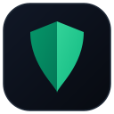
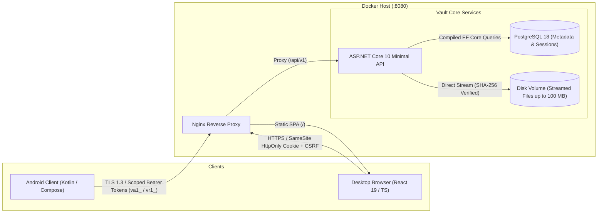

# Vault

<div align="center">



### *A private, self-hosted clipboard and file drop between your PC and Android phone.*

[](https://github.com/axewhyzed/vault/releases)
[-34a853?logo=android&logoColor=white)](https://github.com/axewhyzed/vault/releases)
[-3DDC84?logo=android&logoColor=white)](android/)
[](src/api/Vault.Api)
[](web/)
[](infra/)
[](LICENSE)

---

</div>

## Why Vault?

Ever find yourself emailing a link to yourself, messaging a bot on Telegram or WhatsApp just to copy some text to your phone, or waiting for cloud drive sync just to move a single PDF?

**Vault replaces those workarounds.** It gives you a private, self-hosted inbox that connects your desktop browser and your Android phone directly:

1. **Paste or drop on your PC** - links, text notes, code snippets, or files up to 100 MB.
2. **It arrives on your phone immediately** - with smart one-tap actions to open, copy, or download.
3. **No third-party cloud required** - your data runs on your own hardware, with zero tracking, no ads, and no subscription fees.

---

## Visual Tour

<div align="center">

### Desktop Web Workspace
*Clean two-pane inbox with instant compose, live storage meter, type filters, and real-time search (`/`).*


<br/><br/>

</div>

<table align="center" width="100%">
<tr>
<th width="33%" align="center">📱 Android Inbox & Search</th>
<th width="33%" align="center">⚙️ Settings & Device Hub</th>
<th width="34%" align="center">🔐 Instant Sign-In & Pairing</th>
</tr>
<tr>
<td align="center" valign="top">

<br/>
<sub><i>Local encrypted cache for instant loading, real-time search bar, swipe-to-delete, and one-tap actions.</i></sub>
</td>
<td align="center" valign="top">

<br/>
<sub><i>Live server latency ping, connected devices list, default download folder picker, and cache cleaner.</i></sub>
</td>
<td align="center" valign="top">

<br/>
<sub><i>Pair in 1 second via QR code scan or log in directly with username and password.</i></sub>
</td>
</tr>
</table>

<br/>

<table align="center" width="100%">
<tr>
<th width="50%" align="center">⚡ On-Demand Pairing Modal</th>
<th width="50%" align="center">🛡️ Secure Web Login</th>
</tr>
<tr>
<td align="center" valign="top">

<br/>
<sub><i>One-click QR generator in the topbar with countdown timer and fallback pairing secret.</i></sub>
</td>
<td align="center" valign="top">

<br/>
<sub><i>HttpOnly SameSite cookie isolation, anti-CSRF verification, and rate limiting.</i></sub>
</td>
</tr>
</table>

---

## What You Can Do

- ⚡ **Send in Seconds:** Drop text notes, links, or files up to 100 MB from your desktop browser or phone.
- 📴 **Offline Outbox (Android):** Share a file or type a note while your phone has no internet connection. Vault queues it locally and automatically sends it in the background as soon as connectivity returns.
- 🎯 **Smart One-Tap Actions:**
  - **Links / URLs:** Open directly in your browser or copy the link with one tap.
  - **Text Snippets:** Copy directly to your clipboard.
  - **Files:** Download directly to your chosen default folder (with progress indicator and a toast notification), or open immediately using native Android apps via the system resolver.
- 🔍 **Live Search:** Search received items instantly by file name, text content, payload type, or sending device across both web and mobile.
- 📱 **Connected Devices & Remote Revocation:** Inspect all active devices and browser sessions from the web workspace or Android Hub. Terminate stale sessions remotely with one click.
- 🔄 **Reactive Session State & Auto-Expiry:** 14-day sliding refresh tokens automatically clean up on expiration. Foreground app resumes proactively verify token health without interrupting offline workflows, instantly routing to the sign-in screen if revoked.
- 🧹 **Flexible Retention & Automated Reaper:** Keep items for hours (1-168h) or days (1-7d). An automated background worker sweeps expired items and orphaned files on schedule.
- 📁 **Custom Download Folder (Android):** Choose where files get saved on your phone (e.g. `Downloads/Vault`) using the standard Android folder picker. Once selected, downloads save there automatically without asking each time.
- 🔒 **Granular Session Control:** Log out of your current device with one tap, or revoke all active sessions across all devices from the confirmed security modal.

---

## How It Works Under the Hood

Vault is designed as a lightweight, single-tenant personal relay. It separates metadata storage from file storage to keep database operations fast and memory usage minimal:



### Technical Details

- **Backend API (`src/api/Vault.Api`):** Built with ASP.NET Core 10 Minimal APIs and EF Core. File uploads are streamed directly from HTTP request bodies into a mounted disk volume - files never buffer in server RAM or bloat the database. Uploads calculate SHA-256 hashes on the fly to guarantee payload integrity. Active sessions are automatically deduplicated per physical device/browser to eliminate ghost sessions. An automated background worker periodically cleans expired items and orphaned staging files. In development mode, native OpenAPI 3.1 documentation is served via an interactive Scalar reference at `/scalar/v1`.
- **Desktop Web Client (`web/`):** React 19 + TypeScript single-page application served via Nginx. Session management uses `HttpOnly`, `SameSite=Lax`, encrypted cookies paired with anti-CSRF tokens to protect against cross-origin attacks. Includes real-time connected device inspection, remote device revocation, and keyboard shortcuts (`/` to search, `Escape` to close modals).
- **Android Client (`android/`):** Native Kotlin application built with Jetpack Compose and Material 3.
  - **Branding & Splash:** Custom chiseled dual-tone shield icon and native Android 12+ Splash Screen (`androidx.core:core-splashscreen`) for instantaneous, glitch-free cold launches.
  - **Authentication & Lifecycle:** Scoped bearer tokens (`va1_` access tokens, `vr1_` refresh tokens) stored in Android `EncryptedSharedPreferences`. A reactive `StateFlow` revision synchronizes authentication across Compose layers, immediately routing to login on revocation or expiry. Foreground resume runs a non-intrusive heartbeat (`/api/v1/auth/me`) that remains offline-tolerant.
  - **Background Work:** Uses Android `WorkManager` with network constraints to manage the Outbox queue, retrying uploads gracefully with exponential backoff if connectivity drops.
  - **Storage & System Integration:** Uses Android Storage Access Framework (SAF) with persistable URI permissions for default download folders, and `androidx.core.content.FileProvider` for launching system viewing intents securely.
- **Database (`infra/`):** PostgreSQL 18 stores user credentials (Argon2id/PBKDF2), active device sessions, item metadata, and transfer audit logs.

---

## Quickstart (Self-Hosting with Docker)

### Prerequisites
- [Docker Desktop](https://www.docker.com/products/docker-desktop/) (or Docker Engine with Compose v2)
- PowerShell 7+ (Windows) or Bash (macOS / Linux)
- .NET 10 SDK *(optional, only if building the backend locally)*

### 1. Generate Local Certificates & Credentials
From the repository root, run the setup script:

```powershell
./scripts/setup-local.ps1
```

*What this does: Generates a trusted localhost TLS certificate in `.local/tls/` and generates a secure random bootstrap password in your `.env` file.*

### 2. Start the Stack
```powershell
docker compose up --build -d
```

### 3. Open Your Inbox
Open **<https://localhost:8080>** in your browser.
- **Username:** `owner@vault.local` (or simply `owner`)
- **Password:** The generated password located in your `.env` file as `VAULT_BOOTSTRAP_PASSWORD`

To stop the containers: `docker compose down`.  
To stop and erase all data: `docker compose down --volumes`.

---

## Android App Setup

### 1. Download & Install APK
Download the signed debug build from [GitHub Releases](https://github.com/axewhyzed/vault/releases):

👉 **[Download vault-debug-v0.8.0.apk](https://github.com/axewhyzed/vault/releases)**

Or install directly onto a connected phone or emulator via ADB:
```powershell
adb install -r vault-debug-v0.8.0.apk
```

### 2. Sign In or Pair
- **Option A - Scan QR Code (Recommended):** Click **Pair Phone** in the web topbar, open the app on your phone, and tap **Scan QR Code**. Pairing completes in about one second.
- **Option B - Username & Password:** Tap **Sign In with Credentials**, enter your username and password, and tap Sign In. (The server URL defaults automatically to your host, or can be expanded to point to a custom domain).

Once signed in, the app maintains a 14-day sliding session that refreshes automatically as you use it.

---

## Running Over Local Wi-Fi (Physical Phone)

To connect a physical Android device to Vault running on your computer over your home Wi-Fi:

1. **Install mkcert:**
   ```powershell
   choco install mkcert   # or: scoop install mkcert
   ```
2. **Issue LAN Certificate:**
   Find your computer's local IP address (e.g. `192.168.1.25`) and issue certificates for both `localhost` and your LAN IP:
   ```powershell
   $lanIp = '192.168.1.25'
   ./scripts/setup-local.ps1
   mkcert -install
   mkcert -cert-file .local/tls/dev-cert.pem -key-file .local/tls/dev-cert.key localhost $lanIp
   mkcert -CAROOT
   ```
3. **Trust the Certificate on Android:**
   Copy `rootCA.pem` to your phone and install it:  
   **Settings → Security → Encryption & credentials → Install a certificate → CA Certificate**.
4. **Update `.env`:**
   ```dotenv
   VAULT_WEB_PORT=8080
   VAULT_BIND_ADDRESS=192.168.1.25
   VAULT_LAN_ORIGIN=https://192.168.1.25:8080
   VAULT_SERVER_ORIGIN=https://192.168.1.25:8080
   ```
5. **Build and install Android app configured for your LAN:**
   ```powershell
   cd android
   ./gradlew.bat -PvaultDebugServerOrigin=https://192.168.1.25:8080 assembleDebug
   adb install -r app/build/outputs/apk/debug/app-debug.apk
   ```

---

## Automated Verification & Testing

Vault includes test coverage across the backend, frontend, and mobile clients. Run verification locally before committing changes:

```powershell
# Run backend tests, database migrations, and frontend lint/build checks:
./scripts/test.ps1

# Run Android compilation, MockWebServer unit tests, Compose tests, and Android lint:
./scripts/test-android.ps1
```

---

## Repository Structure

```text
├── src/api/Vault.Api/     # ASP.NET Core 10 Minimal APIs & domain modules (Auth, Storage, Transfers)
├── web/                   # React 19 + TypeScript frontend (Vite, CSS design tokens, Compose Hub)
├── android/               # Native Android client (Jetpack Compose, WorkManager, Encrypted Cache)
├── infra/                 # Nginx reverse proxy configuration, PostgreSQL, and backup automation
├── tests/                 # Integration test suites (.NET test host & Android MockWebServer)
├── docs/assets/           # Screenshots, UI captures, and architectural diagrams
└── scripts/               # One-command verification and local setup automation
```

---

## Contributing & Guidelines

All agents and contributors modifying this repository must follow the architectural boundaries and commit standards detailed in [AGENTS.md](AGENTS.md):

- **Cohesive Batching:** Android changes must represent complete, verified units of work (no micro-commits).
- **Mandatory Local Verification:** Always pass `./scripts/test-android.ps1` before committing any Android code.
- **Zero-Binary Policy:** Never commit `.apk`, `.jar`, `.aar`, `.so`, or `.keystore` files directly to git. Releases and artifacts are built and distributed through GitHub Actions.

---

## License

Vault is open-source software licensed under the [MIT License](LICENSE).
