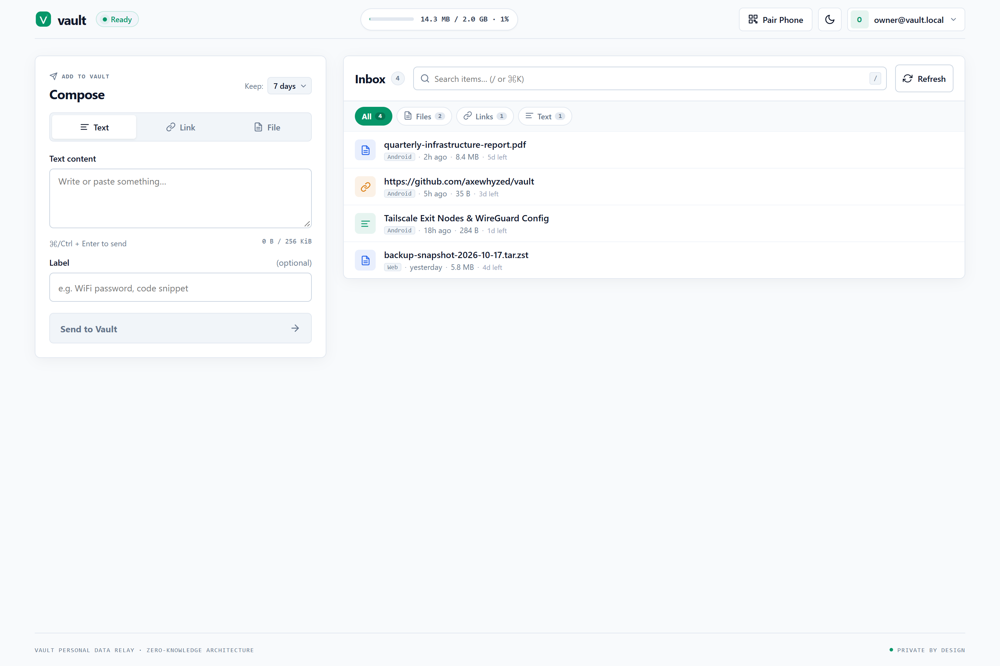
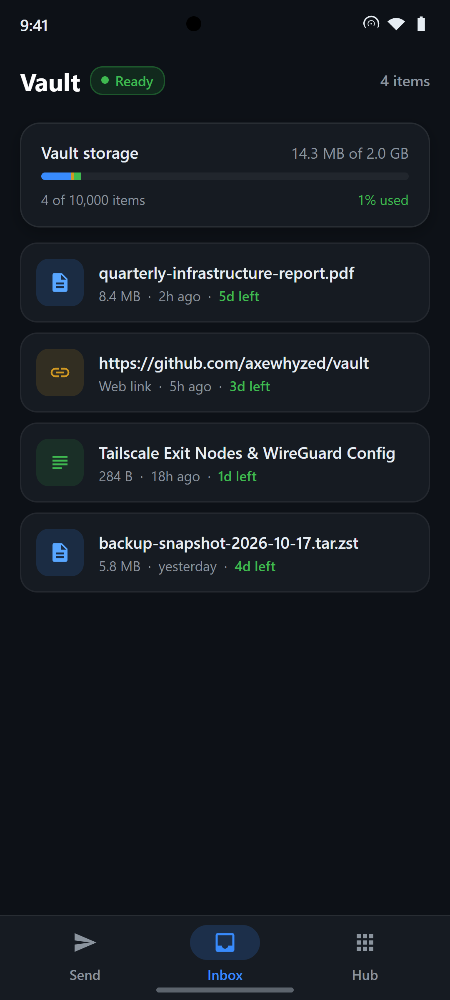
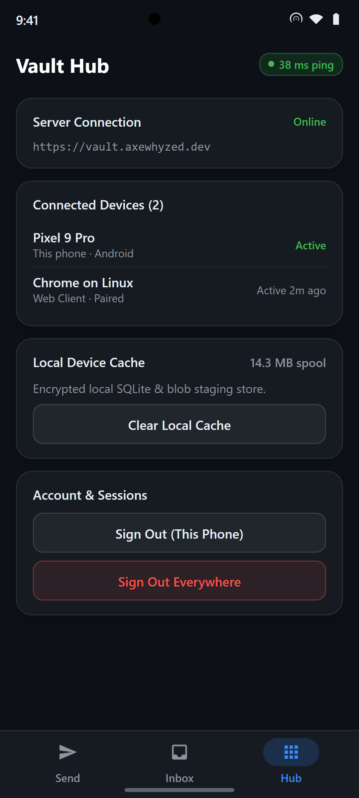
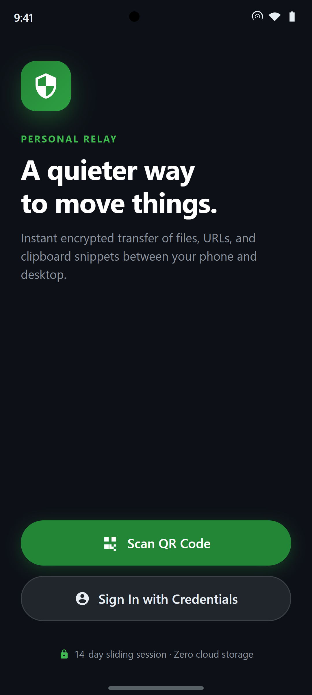
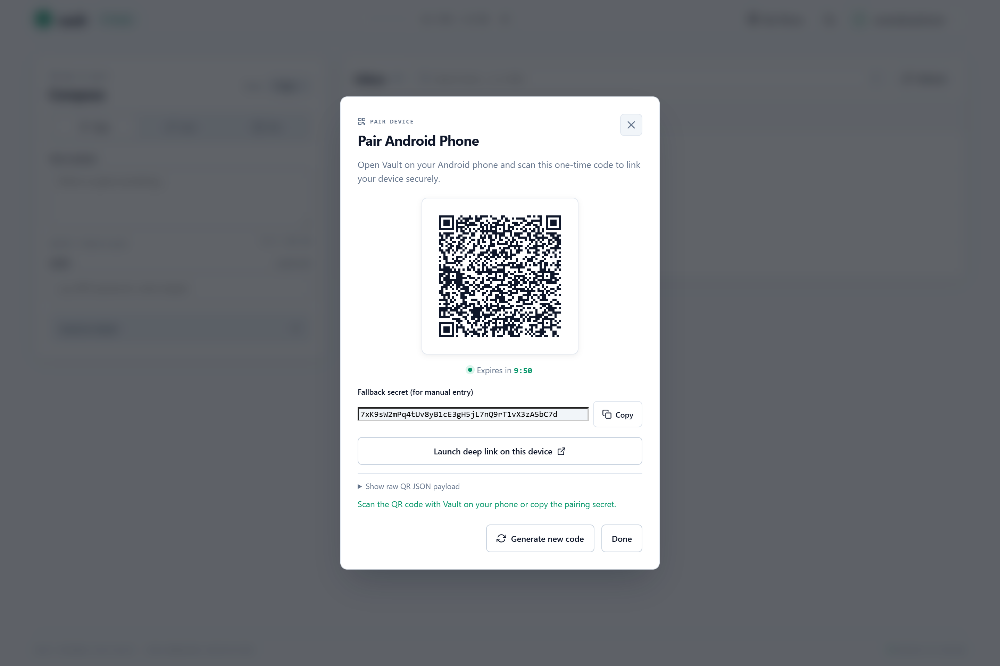
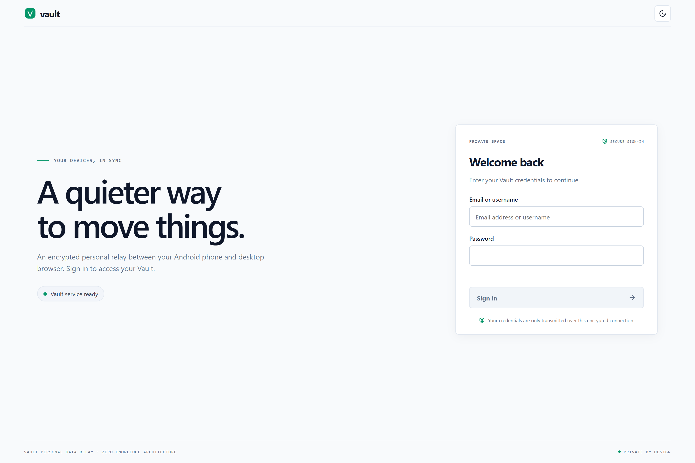
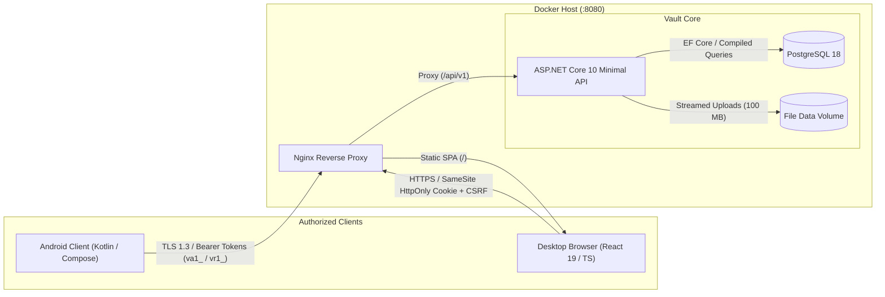

# Vault

<div align="center">

<svg aria-hidden="true" viewBox="0 0 32 32" width="72" height="72"><rect x="2" y="2" width="28" height="28" rx="9" fill="#2b3b2d" /><path d="M9 11.25h2.55l4.45 10.1 4.45-10.1H23l-6.05 13.5h-1.9L9 11.25Z" fill="#f5f4ef" /><circle cx="23.1" cy="8.9" r="1.35" fill="#34a853" /></svg>

### *A quieter way to move things.*

**Encrypted, zero-cloud personal relay & high-density inbox between your desktop browser and Android phone.**

[](https://github.com/axewhyzed/vault/releases)
[](https://github.com/axewhyzed/vault/releases)
[-3DDC84?logo=android&logoColor=white)](android/)
[](src/api/Vault.Api)
[](web/)
[](infra/)
[](LICENSE)

---

</div>

## Overview

**Vault** is a single-owner, self-hosted personal relay engineered to bridge your desktop browser and mobile devices without commercial sync clouds, third-party telemetry, or message clutter.

Effortlessly transfer text snippets, URLs, and files up to 100 MB directly into your personal workspace. Vault features a zero-waste web dashboard with an instant Compose Hub and client-side search, paired with a native Kotlin Jetpack Compose Android client featuring offline-resilient encrypted caching, swipe gestures, and real-time connectivity telemetry.

---

## Visual Showcase

<div align="center">

### Modernized Web Workspace
*High-density 2-pane workspace featuring an instant Compose Hub, live storage meter, type filtering, instant search (`/`), and Obsidian Dark / Crisp Light theming.*



<br/><br/>

</div>

<table align="center" width="100%">
<tr>
<th width="33%" align="center">📱 Native Android Inbox</th>
<th width="33%" align="center">⚡ Hub & Telemetry</th>
<th width="34%" align="center">🔐 Seamless Authentication</th>
</tr>
<tr>
<td align="center" valign="top">

<br/>
<sub><i>Zero-skeleton SWR cache with storage quota progress, color-coded badges, and swipe-to-delete.</i></sub>
</td>
<td align="center" valign="top">

<br/>
<sub><i>Live server ping latency, connected devices registry, local spool cache cleaner, and granular logout.</i></sub>
</td>
<td align="center" valign="top">

<br/>
<sub><i>Camera QR scanning or direct username/password login with 14-day sliding session refresh.</i></sub>
</td>
</tr>
</table>

<br/>

<table align="center" width="100%">
<tr>
<th width="50%" align="center">⚡ On-Demand Pairing Modal</th>
<th width="50%" align="center">🛡️ Defensive Web Sign-In</th>
</tr>
<tr>
<td align="center" valign="top">

<br/>
<sub><i>Vector QR generator with live 10-minute countdown timer, fallback secret copy box, and deep link launcher.</i></sub>
</td>
<td align="center" valign="top">

<br/>
<sub><i>Strict anti-forgery verification, rate limiting, and HttpOnly SameSite cookie isolation.</i></sub>
</td>
</tr>
</table>

---

## Key Highlights

- 🔒 **Zero-Cloud Privacy:** You own the infrastructure. Data moves strictly between your own server and authenticated devices—zero third-party tracking, ads, or message scraping.
- ⚡ **Zero-Waste Web Architecture:** Completely eliminated giant hero banners. The 56px topbar integrates a live storage pill meter (`14 MB / 2 GB`), quick-action pairing modal, theme switcher, and an accessible user menu.
- 🚀 **Unified Compose Hub:** Send snippets, links, or files from a single segmented tab container with drag-and-drop staging, live UTF-8 byte counting, and configurable retention (1, 3, or 7 days).
- 📱 **Native Android Client (Material 3):**
  - **Direct Authentication:** Scan a QR code or sign in directly with username and password—no tedious URL copying.
  - **14-Day Sliding Sessions:** Sessions persist seamlessly with automatic token sliding window on active app usage (auto-logout after 14 days of inactivity).
  - **Zero-Skeleton SWR Caching:** Local SQLite & encrypted storage caches inbox rows for 10+ minutes, eliminating blank screen flashes on tab navigation.
  - **Full Item Management:** Delete items directly from Android with confirmation dialogs or rapid swipe-to-dismiss.
  - **Vault Hub:** Replaces redundant activity tabs with real-time server latency ping, connected device tracking, local spool cleaner, and a confirmed Danger Zone.
- 🔍 **Instant Search & Type Filtering:** Filter items instantly by type (`Files`, `Links`, `Text`) or execute real-time keyword search via `/` or `⌘K`.
- 📦 **100 MB Direct Streaming:** Stream large attachments directly into isolated disk volumes with SHA-256 integrity verification—bypassing database bloat.
- 🛡️ **Granular vs. Global Revocation:** Log out of your current device cleanly, or trigger a global session revocation from the confirmed security modal.

---

## Architecture



---

## Quickstart (60 Seconds)

### Prerequisites
- [Docker Desktop](https://www.docker.com/products/docker-desktop/) with Compose v2
- PowerShell 7+ (Windows) or Bash (macOS/Linux)
- .NET 10 SDK (for local verification)

### 1. Generate Local Credentials & TLS
Run the local setup script from repository root:
```powershell
./scripts/setup-local.ps1
```
*This generates a trusted localhost development certificate in `.local/tls/` and configures a high-entropy bootstrap password in `.env`.*

### 2. Launch the Stack
```powershell
docker compose up --build -d
```

### 3. Open Your Inbox
Open **<https://localhost:8080>** in your browser.
- **Identifier:** `owner@vault.local` (or `owner`)
- **Password:** Found in `.env` as `VAULT_BOOTSTRAP_PASSWORD`

To shut down and retain data: `docker compose down`. To purge all data and keys: `docker compose down --volumes`.

---

## Android Client Setup

### 1. Download & Install APK
Download the signed build from [GitHub Releases](https://github.com/axewhyzed/vault/releases):

👉 **[Download vault-debug-v0.2.0.apk](https://github.com/axewhyzed/vault/releases)**

Or install directly via ADB:
```powershell
adb install -r vault-debug-v0.2.0.apk
```

### 2. Pair or Sign In in Seconds
1. In your desktop Vault inbox, click **Pair Phone** in the topbar.
2. Open Vault on your phone and tap **Scan QR Code** to point your camera at the screen.
3. *Alternatively*, tap **Sign In with Credentials** to enter your server address, username, and password directly.

Your device maintains a 14-day sliding session that automatically refreshes as you use the app.

---

## Local LAN & Physical Device Testing

To connect a physical Android phone to your PC over local Wi-Fi:

1. **Install mkcert:**
   ```powershell
   choco install mkcert   # or: scoop install mkcert
   ```
2. **Issue LAN Certificate:**
   Find your PC's local IP (e.g., `192.168.1.25`) and issue the certificate:
   ```powershell
   $lanIp = '192.168.1.25'
   ./scripts/setup-local.ps1
   mkcert -install
   mkcert -cert-file .local/tls/dev-cert.pem -key-file .local/tls/dev-cert.key localhost $lanIp
   mkcert -CAROOT
   ```
3. **Install Public CA on Android:**
   Copy `rootCA.pem` to your Android device and install it under **Settings → Security → Install a Certificate → CA Certificate**.
4. **Update `.env`:**
   ```dotenv
   VAULT_WEB_PORT=8080
   VAULT_BIND_ADDRESS=192.168.1.25
   VAULT_LAN_ORIGIN=https://192.168.1.25:8080
   VAULT_SERVER_ORIGIN=https://192.168.1.25:8080
   ```
5. **Rebuild Android App for LAN:**
   ```powershell
   cd android
   ./gradlew.bat -PvaultDebugServerOrigin=https://192.168.1.25:8080 assembleDebug
   ```

---

## Automated Verification

Vault enforces full end-to-end verification locally before any deployment:

```powershell
# Full backend, database migrations, security headers, and frontend test suite:
./scripts/test.ps1

# Android client build, unit tests (MockWebServer), and linting:
./scripts/test-android.ps1
```

---

## Repository Structure

```text
├── src/api/Vault.Api/     # ASP.NET Core 10 Minimal APIs & domain modules (Identity, Storage, Transfers)
├── web/                   # React 19 + TypeScript frontend (Vite, CSS tokens, Compose Hub)
├── android/               # Native Android application (Jetpack Compose, WorkManager, Encrypted Cache)
├── infra/                 # Nginx proxy configuration, PostgreSQL, and backup scripts
├── tests/                 # Unit, integration, and security test suites (.NET & Android MockWebServer)
├── docs/assets/           # Screenshots, UI captures, and architectural diagrams
└── scripts/               # One-command verification and local setup automation
```

---

## Contributing & Guidelines

All agents and contributors modifying this repository must follow the architectural boundaries and commit hygiene defined in [AGENTS.md](AGENTS.md).

- **Cohesive Batching:** No single-line or micro-commits to `android/**`.
- **Pre-commit Verification:** Always pass `./scripts/test-android.ps1` before committing Android modifications.
- **Zero-Binary Policy:** Never commit `.apk`, `.jar`, `.so`, or `.keystore` binaries to git.

---

## License

Vault is open-source software licensed under the [MIT License](LICENSE).
