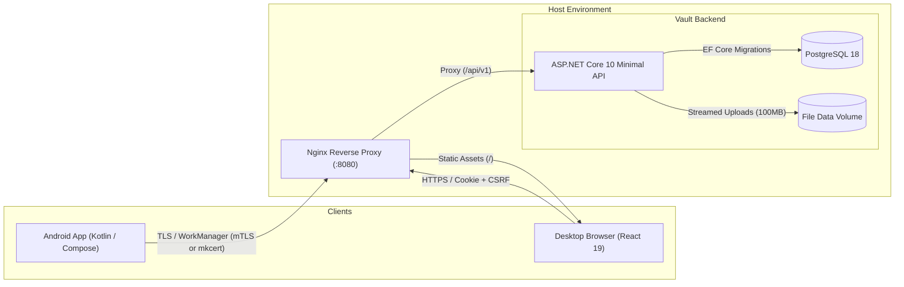

# Vault

<div align="center">

<svg aria-hidden="true" viewBox="0 0 32 32" width="72" height="72"><rect x="2" y="2" width="28" height="28" rx="9" fill="#2b3b2d" /><path d="M9 11.25h2.55l4.45 10.1 4.45-10.1H23l-6.05 13.5h-1.9L9 11.25Z" fill="#f5f4ef" /><circle cx="23.1" cy="8.9" r="1.35" fill="#b9d48e" /></svg>

### *A quieter way to move things.*

**Private, self-hosted cross-device relay & inbox between your desktop and Android phone.**

[](https://github.com/axewhyzed/vault/releases)
[](https://github.com/axewhyzed/vault/releases/download/v0.1.0/vault-debug-v0.1.0.apk)
[-3DDC84?logo=android&logoColor=white)](android/)
[](src/api/Vault.Api)
[](web/)
[](infra/)
[](LICENSE)

---

</div>

## Overview

**Vault** is a single-owner, zero-cloud relay that bridges your phone and computer without relying on commercial sync clouds, third-party relays, or message history retention. 

Share links, snippets, photos, and files up to 100 MB from Android's native share sheet into your private desktop browser inbox, then retrieve recent owner items in the Android app. The Android inbox is read-only: text can be copied, HTTP(S) links open in the browser, and verified files can be saved through Android's document picker. Retrieval is on app open/foreground and manual refresh; there are no push alerts or cached inbox. Items expire automatically within 1 to 7 days.

---

## Visual Showcase

<div align="center">

### Web Desktop Inbox & Staging
*Single-view inbox with live storage quota tracking, multi-device origin indicators, and instant text/link upload.*


<br/><br/>

</div>

<table align="center" width="100%">
<tr>
<th width="45%" align="center">📱 Native Android Client</th>
<th width="55%" align="center">⚡ Zero-Trust Device Pairing</th>
</tr>
<tr>
<td align="center" valign="top">

<br/>
<sub><i>Paired Android client receiving a shared link via the native system share sheet with retention selection and upload history.</i></sub>
</td>
<td align="center" valign="top">

<br/>
<sub><i>10-minute ephemeral pairing session with QR scanner payload, manual paste secret, and deep-link protocol fallback.</i></sub>
</td>
</tr>
</table>

<br/>

<details>
<summary><b>View Secure Sign-in Screen</b></summary>
<br/>
<p align="center">
  
  <br/>
  <em>Defensive authentication with anti-forgery verification, rate limiting, and cookie session isolation.</em>
</p>
</details>

---

## Key Highlights

- 🔒 **Zero-Cloud Privacy:** You own the infrastructure. Data moves exclusively through your own server—no third-party telemetry, ads, or data retention.
- 📱 **Native Android Share Sheet:** Tap "Share" from any Android app (Chrome, Twitter, Photos, Files) to queue uploads straight to your personal desktop inbox.
- ⏱️ **Auto-Expiring Ephemerality:** Choose a 1-day, 3-day, or 7-day retention period for every item. Vault automatically cleans up expired items and files.
- 📦 **100 MB Direct Streaming:** Stream large attachments and binaries directly into isolated volume storage with SHA-256 integrity verification—avoiding database bloat.
- ⚡ **Lightweight & High-Performance:** Powered by ASP.NET Core 10 Minimal APIs with Workstation GC and EF Core compiled queries.
- 🛡️ **Instant Global Revocation:** One-click "Sign out everywhere" immediately invalidates all web sessions and Android refresh tokens across your devices.

---

## Architecture



---

## Quickstart (60 Seconds)

### Prerequisites
- [Docker Desktop](https://www.docker.com/products/docker-desktop/) with Compose v2
- PowerShell 7+ (Windows) or Bash (macOS/Linux)
- .NET 10 SDK (for local verification)

### 1. Generate Local Credentials & TLS
Run the local setup script from repository root:
```powershell
./scripts/setup-local.ps1
```
*This exports a trusted localhost development certificate to `.local/tls/` and creates a high-entropy bootstrap password in `.env`.*

### 2. Launch the Stack
```powershell
docker compose up --build -d
```

### 3. Open Your Inbox
Open **<https://localhost:8080>** in your browser.
- **Identifier:** `owner@vault.local` (or `owner`)
- **Password:** Found in `.env` as `VAULT_BOOTSTRAP_PASSWORD`

To shut down and retain data: `docker compose down`. To purge all data and keys: `docker compose down --volumes`.

---

## Android Client Setup

### 1. Download & Install APK
Download the signed debug build from [GitHub Releases](https://github.com/axewhyzed/vault/releases):

👉 **[Download vault-debug-v0.1.0.apk](https://github.com/axewhyzed/vault/releases/download/v0.1.0/vault-debug-v0.1.0.apk)**

Or install directly via ADB:
```powershell
adb install -r vault-debug-v0.1.0.apk
```

### 2. Pair Your Phone in 3 Steps
1. In your desktop Vault inbox, click **Generate pairing code**.
2. Open the Vault app on Android and tap **Scan QR** (or paste the JSON/deep-link).
3. Verify your device name and tap **Pair phone**.

Your phone is now paired with Vault. In the app, choose **Send** to write text, add a link, or pick a file, review it, and send it. You can also send from Android's **Share** menu. Use **Inbox** to retrieve PC-sent items and **Activity** to check your sends.

The Inbox loads when the app opens or returns to the foreground; use **Refresh** and **Load more** for explicit retrieval. See [Android send](docs/android-send.md) and [Android receive](docs/android-receive.md) for the phone workflows, build commands, and verification boundaries.

---

## Local LAN & Physical Device Testing

To test between a physical Android phone and your PC over your local Wi-Fi:

1. **Install mkcert:**
   ```powershell
   choco install mkcert   # or: scoop install mkcert
   ```
2. **Issue LAN Certificate:**
   Find your PC's local IP (e.g., `192.168.1.25`) and issue the certificate:
   ```powershell
   $lanIp = '192.168.1.25'
   ./scripts/setup-local.ps1
   mkcert -install
   mkcert -cert-file .local/tls/dev-cert.pem -key-file .local/tls/dev-cert.key localhost $lanIp
   mkcert -CAROOT
   ```
3. **Install Public CA on Android:**
   Copy `rootCA.pem` to your Android device and install it under **Settings → Security → Install a Certificate → CA Certificate**.
4. **Update `.env`:**
   ```dotenv
   VAULT_WEB_PORT=8080
   VAULT_BIND_ADDRESS=192.168.1.25
   VAULT_LAN_ORIGIN=https://192.168.1.25:8080
   VAULT_SERVER_ORIGIN=https://192.168.1.25:8080
   ```
5. **Rebuild Android App for LAN:**
   ```powershell
   cd android
   ./gradlew.bat -PvaultDebugServerOrigin=https://192.168.1.25:8080 assembleDebug
   ```

---

## Automated Verification

Vault enforces full end-to-end verification locally:

```powershell
# Full backend, database migrations, security headers, and frontend test suite:
./scripts/test.ps1

# Android client build, unit tests (MockWebServer), and linting:
./scripts/test-android.ps1
```

---

## Repository Structure

```text
├── src/api/Vault.Api/     # ASP.NET Core 10 Minimal APIs & domain modules
├── web/                   # React 19 + TypeScript frontend (Vite)
├── android/               # Native Android application (Jetpack Compose, WorkManager)
├── infra/                 # Nginx proxy configuration, PostgreSQL, and backup scripts
├── tests/                 # Unit, integration, and security test suites
├── docs/assets/           # Screenshots, UI captures, and architectural diagrams
└── scripts/               # One-command verification and local setup automation
```

---

## Contributing & Guidelines

All agents and contributors modifying this repository must follow the architectural boundaries and commit hygiene defined in [AGENTS.md](AGENTS.md).

- **Cohesive Batching:** No single-line or micro-commits to `android/**`.
- **Pre-commit Verification:** Always pass `./scripts/test-android.ps1` before committing Android modifications.
- **Zero-Binary Policy:** Never commit `.apk`, `.jar`, `.so`, or `.keystore` binaries to git.

---

## License

Vault is open-source software licensed under the [MIT License](LICENSE).
